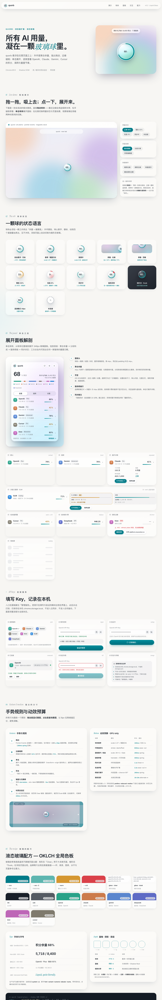

# quorb

**液态玻璃悬浮球 · 一眼看尽 AI 用量。** 内置 GLM Coding Plan（智谱）适配器，
同一服务商可并行多条连接（如个人版 + 团队席位三要素），球体显示所有参与连接中最紧的剩余百分比。



## 安装（开发者模式）

0. 首次（或源码变更后）：`npm install && npm run build` —— 内容脚本由 ES module 打包为 `dist/content/index.js`
1. 打开 `chrome://extensions` → 右上角开启「开发者模式」
2. 「加载已解压的扩展程序」→ 选择本目录（含 `manifest.json`）
3. 固定 quorb 图标；在任意网页上即可看到悬浮球

> 首次使用：点击悬浮球打开侧边栏 → 「前往连接」（或悬浮球面板 → 「连接服务」）→ 添加连接 →
> 向导按所选服务商的 schema 渲染字段（区域 / API Key / 组织 ID / 项目 ID）→ 验证并保存。
> 可重复添加多条连接；在面板「管理连接」或设置页中启停 / 编辑 / 删除 / 排序 / 调整同步频率。

## API Key

- 获取：[bigmodel.cn 控制台](https://bigmodel.cn/console)（大陆）或
  [z.ai](https://z.ai/manage-apikey/apikey-list)（国际）；团队席位 Key 另见[用量接口参考](docs/glm-usage-api.md)
- 存储：**仅本机 `chrome.storage.local`**，不使用 storage.sync、不进云备份；界面上永远打码显示
- 权限：`tabs` + 全站 host 用于「安装/重载后向已打开标签页常驻注入悬浮球」——这是悬浮球常驻的必要条件
- 请求：只发往所选区域的官方域名（`open.bigmodel.cn` / `api.z.ai`）

## 展示口径

球心数字 = **所有参与连接**最紧窗口余量百分比（跨连接取 min；管理里可改「球体只盯某条连接」），
面板聚合 Hero + 每连接一张卡；停用 / 鉴权失败 / 同步出错 / 无快照 / 数据过期的连接**不进全局 min**。
完整聚合与排除规则见 [docs/architecture.md §6](docs/architecture.md)。

## 交互

拖动自由放置 · 靠近屏幕边缘磁吸停靠（月牙收拢，悬停滑出）· **单击打开侧边栏面板（全浏览器唯一实例）** · 双击悬浮↔停靠切换 · Esc 关闭向导 · 位置记忆

## 数据源

GLM 用量接口未在官方文档公开，quorb 已通过真实账号实测确认调用方式、响应语义与团队席位
三要素配方，详见 [docs/glm-usage-api.md](docs/glm-usage-api.md)。
若官方调整接口：改 `src/providers/glm.js` 即可，UI 不需要动。

## 本地验证

```bash
npm run build                      # 打包内容脚本 → dist/content/index.js
npm run check                      # 全部 JS 语法检查 + 构建
npm test                           # 单元测试（node --test，纯逻辑）
python3 test/serve.py              # http://127.0.0.1:8907
# 浏览器打开 /test/harness.html     → HARNESS PASS（解析 + 多连接聚合排除 + schema 可序列化断言）
# 浏览器打开 /test/page.html        → 无需安装扩展预览三连接场景（个人 / 团队 / 过期演示，mock 数据）
```

## 已知边界

- 仅内置 GLM 适配器；codex / Claude / 火山引擎等按 [docs/architecture.md §11](docs/architecture.md) 指南接入 ——
  只改 providers + icons + fixtures，UI 与后台零改动
- 用量接口为非公开接口，字段以「调试 → 原始返回」为准；若官方给出公开接口请提 issue
- 深色页面自动切换 Dusk 形态玻璃；`prefers-reduced-motion` 下动画退化

## 文档

| 文档 | 内容 |
|---|---|
| [docs/architecture.md](docs/architecture.md) | 多服务商架构规划：决策记录 / 契约 / 存储模型 / 任务拆解 / 新增服务商指南 / 项目结构 |
| [docs/glm-usage-api.md](docs/glm-usage-api.md) | GLM 用量接口实测参考：调用方式 / 响应语义 / 团队席位三要素 |
| [design/DESIGN.md](design/DESIGN.md) | 界面设计规范：液态玻璃配方 / 色板 / 球体与面板 / 密钥安全边界 |
| [docs/best-practices.md](docs/best-practices.md) | 开发踩坑记录：13 条最佳实践 |

## License

[MIT](LICENSE)
